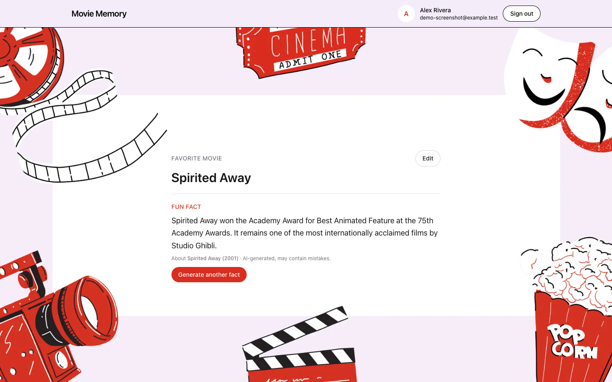

# Movie Memory

Sign in with Google, save your favorite movie, and get fun facts about it written by OpenAI.

Live app: https://moviememory-app.vercel.app

Built for the Scowtt take-home, Variant B (frontend/API).

- [Architecture, decisions and trade-offs](docs/ARCHITECTURE.md): how it works, why Variant B, schema and caching decisions, failure handling, and what I'd do next
- [How I used AI](docs/AI_USAGE.md)

Stack: Next.js 16 (App Router), React 19, TypeScript, Tailwind CSS 4, Postgres on Neon, Prisma 7, Auth.js v5 (Google), the OpenAI SDK, Zod, Vitest and React Testing Library.

## Screenshots

The sign-in page:


The dashboard, with the favorite movie, inline Edit, and a generated fact showing which film the model identified:



## Setup

You need:

- Node 22.12 or newer (Vitest 5 doesn't run on Node 20)
- A Postgres database. I used Neon; any Postgres 14+ works.
- A Google OAuth client of type "Web application", with this authorized redirect URI:
  `http://localhost:3000/api/auth/callback/google`
- An OpenAI API key

Then:

```bash
npm install            # also generates the Prisma client
cp .env.example .env   # fill in the values below
npm run db:migrate     # creates the tables
npm run dev            # http://localhost:3000
```

Put your values in `.env` rather than `.env.local`. Next.js reads both, but the Prisma CLI only reads `.env`.

## Environment variables

| Variable | What it's for |
|---|---|
| `DATABASE_URL` | Pooled Postgres connection, used by the app. On Neon the host contains `-pooler`. |
| `DIRECT_URL` | Direct (unpooled) connection, used only by Prisma migrations. |
| `AUTH_SECRET` | Random string for Auth.js, e.g. from `openssl rand -base64 32`. |
| `AUTH_GOOGLE_ID` | Google OAuth client ID. |
| `AUTH_GOOGLE_SECRET` | Google OAuth client secret. |
| `OPENAI_API_KEY` | OpenAI API key. |
| `OPENAI_MODEL` | Model to use. I used `gpt-5.4-mini-2026-03-17`; a dated version keeps results consistent. |

All of these are read on the server only. None reach the browser.

## Database migrations

Migrations are in `prisma/migrations`. They run against `DIRECT_URL`, because Prisma Migrate doesn't work through a connection pooler.

- `npm run db:migrate` applies migrations during development.
- `npx prisma migrate deploy` applies them in production or CI.
- `npm run db:generate` regenerates the Prisma client after a schema change.

There are two migrations: `init` (the Auth.js tables and `MovieFact`) and `add_fact_identified_title` (one nullable column).

## Tests

```bash
npm run lint
npm run typecheck
npm test          # unit and component tests; the database and OpenAI are mocked
npm run test:db   # integration tests against the real database in DATABASE_URL
npm run build
```

`test:db` creates a few temporary users (`itest-…@example.test`) and deletes them afterwards. Run it against a development database only. In my setup, local development and the deployed app share one Neon database (see the trade-offs), so I'd give production its own Neon branch before running these tests regularly.

## Deployment

The live app runs on Vercel:

1. Set the environment variables above in the Vercel project, for the Production environment. `DIRECT_URL` isn't needed there.
2. Add `https://<your-domain>/api/auth/callback/google` as a redirect URI on the Google OAuth client.
3. Run `npx prisma migrate deploy` against the production database before deploying schema changes.

Outside Vercel (for example `npm run build && npm start` on your own server), also set `AUTH_TRUST_HOST=true` or `AUTH_URL`. Without one of them, Auth.js rejects the host and nobody can sign in. On Vercel this is automatic.

If Google shows "access blocked" on the live app, the OAuth consent screen is in testing mode and your Google account needs to be added as a test user.
